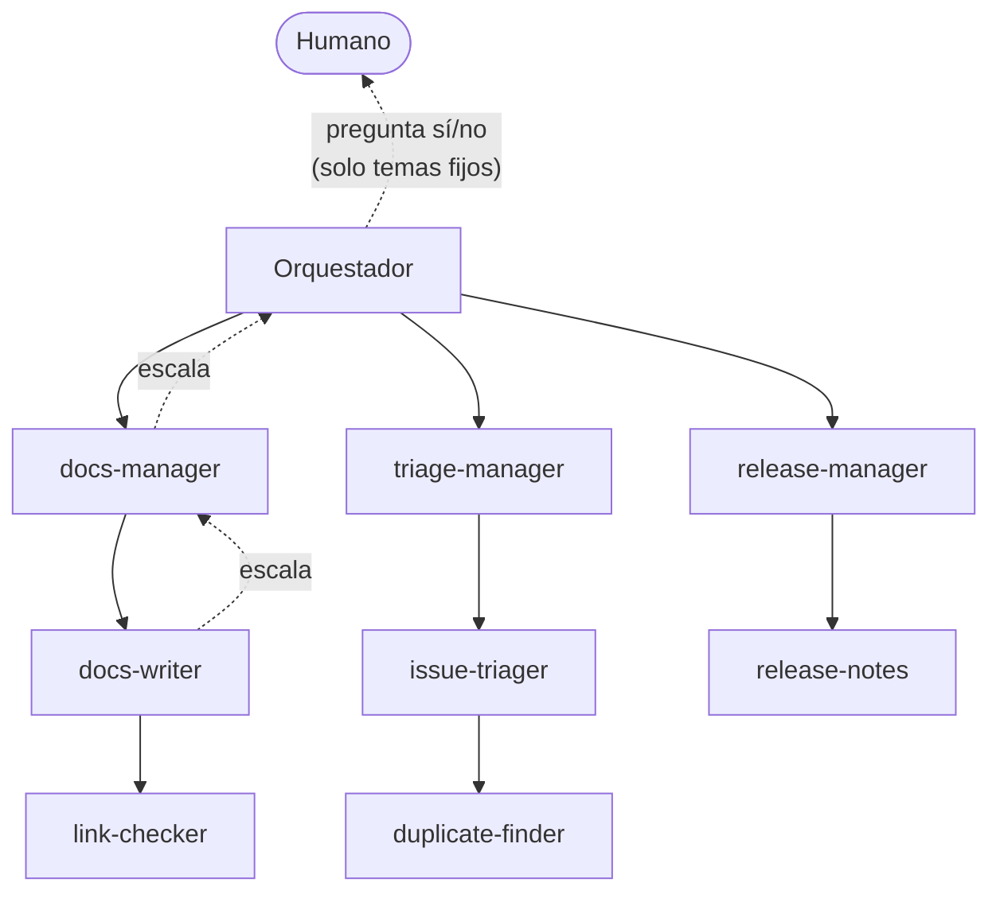

# bedrock-agent-hierarchy

[](https://deepwiki.com/victorgalloo/bedrock-agent-hierarchy)
[](https://github.com/victorgalloo/bedrock-agent-hierarchy/actions/workflows/ci.yml)

[English](README.md) | Español

> **Estado: temprano.** Andamiaje v0. Las APIs van a cambiar.

Una plantilla pequeña y tipada en Python para **jerarquías gerente → subagente sobre Amazon Bedrock**.

## Qué es y por qué

Cuando las rutinas programadas de agentes pasan de cien, el problema deja de ser «¿funciona cada
una?» y pasa a ser **«¿quién se entera cuando una deja de funcionar?»**. Este proyecto extrae un
patrón que corre en producción (más de 100 rutinas programadas): un **orquestador** que decide solo,
**gerentes** de área que responden por un resultado, **agentes** que hacen el trabajo y
**subagentes** que hacen una sola cosa.

Los gerentes nunca le escriben a una persona. Le reportan al orquestador, y solo un conjunto fijo
de decisiones llega a un humano, como una pregunta de sí o no.



## Inicio rápido

```bash
pip install -e ".[dev]"            # agrega ",bedrock" para boto3
python -m agent_hierarchy validate examples/org.yaml
pytest
```

```python
from agent_hierarchy import ChangeManager, HumanQuestion, Topic, escalate, escalate_to_human, load_org

org = load_org("examples/org.yaml")
escalate(org, "docs-writer", "dos corridas fallidas seguidas")   # -> docs-manager

escalate_to_human(org, "orchestrator", Topic.MONEY, HumanQuestion(
    question="¿Apruebo el plan anual de hosting de la documentación?",
    if_yes="La documentación pasa al plan de pago la próxima semana.",
    if_no="La documentación sigue en el plan gratuito con los límites actuales.",
))

cm = ChangeManager(org, root="examples", state_dir=".agent_hierarchy")
change = cm.request("docs-manager", "run-1", "docs-writer", "prompts/docs-writer.md",
                    why="Omitió los requisitos dos veces", measure="Páginas con requisitos, próximas 3 corridas")
# Change -> edita el archivo; Escalation -> el archivo estaba ocupado y se escaló al orquestador.
```

Los modelos corren con la API Converse de Bedrock (`BedrockModel("<id-de-modelo-claude-o-inference-profile>")`);
las pruebas usan `FakeModel` y nunca tocan la red.

## Monitorear un área sin llamar al modelo

Ejecuta dos veces el ejemplo del área ficticia de documentación desde la raíz del repositorio:

```bash
python examples/monitor_area.py .agent_hierarchy/demo/docs.json
python examples/monitor_area.py .agent_hierarchy/demo/docs.json
```

Si el archivo aún no existe, la primera revisión muestra `wake: first run`; con los mismos datos,
la siguiente muestra `skip`. En una tarea programada, llama a `collect_snapshot` con la fecha de
revisión y el historial de corridas de un área (de la más antigua a la más reciente; incluye
corridas previas a la última revisión si hacen falta para detectar fallos consecutivos). Pasa los
identificadores de las rutinas bloqueadas, las caídas de KPI detectadas y los conflictos entre
agentes, además del número de encargos abiertos. Quien llama a la función lee sus propios registros
y decide qué se considera una caída de KPI o un conflicto.

Usa un archivo de estado distinto para cada área. En cada revisión, carga el estado anterior,
llama a `should_wake` y guarda el estado actual después de atender el resultado, incluso si no
despiertas al gerente. Esto permite detectar como nueva una excepción que se resolvió y volvió a
aparecer. Una nueva semana ISO o cualquier encargo abierto también despierta al gerente. No
ejecutes revisiones simultáneas de la misma área para que no se sobrescriba su estado.

## Reglas de diseño

1. **El organigrama es un dato.** `org.yaml` es la única fuente de verdad y se valida al cargarse.
2. **Se escala un nivel a la vez.** Subagente → agente → gerente → orquestador. Solo el orquestador
   llega a un humano, y solo por: dinero, legal, compromisos externos, publicaciones a nombre de
   alguien, accesos y sesiones, hablar a nombre de alguien.
3. **Una pregunta por escalamiento a humano.** Sí o no, con qué pasa si sí y qué pasa si no; si pide
   una acción, la liga exacta a donde se hace.
4. **Cambios reversibles.** Un gerente cambia como máximo 2 archivos de prompt/skill de sus propios
   agentes por corrida. Cada cambio se respalda antes, se registra con *por qué* y *cómo se mide*,
   se evalúa después de N corridas (3 por defecto) y se restaura solo si el resultado es «revertir».
5. **Archivos ocupados.** Si otro revisor tocó un archivo hoy o ayer, se escala en lugar de editarlo.
6. **Despertar solo cuando algo cambió.** Un monitor barato decide si hace falta correr al gerente
   (excepción nueva, semana nueva, encargo abierto). Si no, no hay llamada al modelo.

## Estructura

| Módulo | Estado |
|---|---|
| `agent_hierarchy/org.py` | Carga y validación del organigrama |
| `agent_hierarchy/escalation.py` | Rutas de escalamiento y preguntas a humanos |
| `agent_hierarchy/changes.py` | Respaldo, límite de cambios, archivos ocupados, evaluación, restauración |
| `agent_hierarchy/monitor.py` | Recopila señales del área, guarda el estado y decide si despierta al gerente |
| `agent_hierarchy/bedrock.py` | Stub: adaptador Converse + `FakeModel` (tool use pendiente) |
| `agent_hierarchy/evals.py` | Stub: califica corridas grabadas (ciclo de replay pendiente) |

## Ligas

- Open source de Omona: <https://omona.tech/open-source>
- [Cómo contribuir](CONTRIBUTING.md) · [Código de conducta](CODE_OF_CONDUCT.md) · [Seguridad](SECURITY.md)

Licencia [Apache-2.0](LICENSE).
