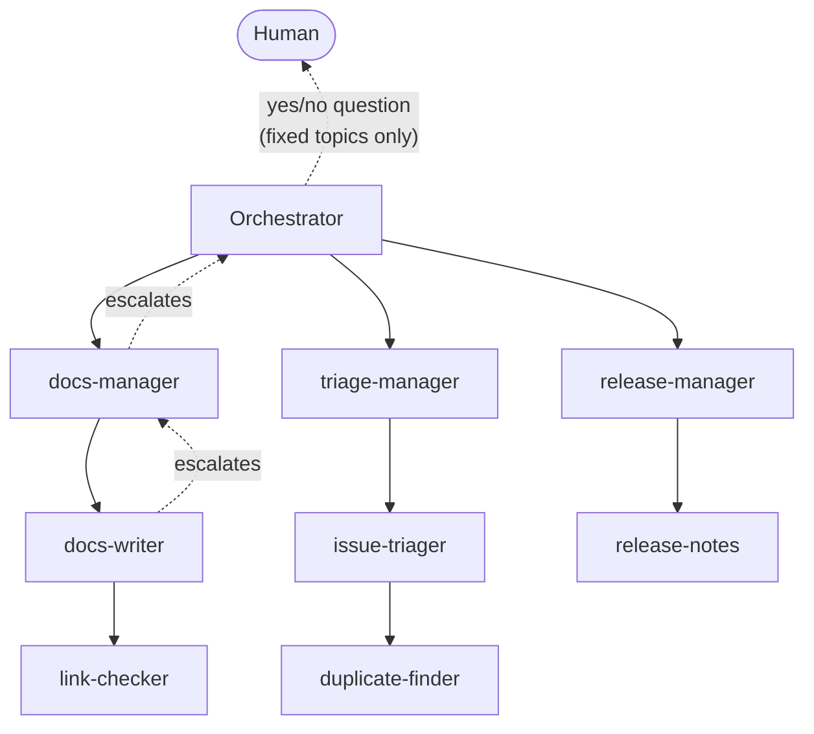

# bedrock-agent-hierarchy

[](https://deepwiki.com/victorgalloo/bedrock-agent-hierarchy)
[](https://github.com/victorgalloo/bedrock-agent-hierarchy/actions/workflows/ci.yml)

English | [Español](README.es.md)

> **Status: early.** v0 scaffold. APIs will change.

A small, typed Python template for **manager → sub-agent hierarchies on Amazon Bedrock**.

## What and why

When scheduled agent routines pass a hundred, the hard part stops being "does each one work" and
becomes **"who notices when one stops working"**. This project extracts a pattern that runs in
production (100+ scheduled routines): an **orchestrator** that decides alone, **area managers** that
own an outcome, **agents** that do the work and **sub-agents** that do one thing each.

Managers never message a person. They report to the orchestrator, and only a fixed set of
decisions reaches a human, as one yes/no question.



## Quick start

```bash
pip install -e ".[dev]"            # add ",bedrock" for boto3
python -m agent_hierarchy validate examples/org.yaml
pytest
```

```python
from agent_hierarchy import ChangeManager, HumanQuestion, Topic, escalate, escalate_to_human, load_org

org = load_org("examples/org.yaml")
escalate(org, "docs-writer", "two failed runs in a row")      # -> docs-manager

escalate_to_human(org, "orchestrator", Topic.MONEY, HumanQuestion(
    question="Approve the yearly docs hosting plan?",
    if_yes="Docs move to the paid plan next week.",
    if_no="Docs stay on the free plan with the current limits.",
))

cm = ChangeManager(org, root="examples", state_dir=".agent_hierarchy")
change = cm.request("docs-manager", "run-1", "docs-writer", "prompts/docs-writer.md",
                    why="Skipped prerequisites twice", measure="Pages with prerequisites, next 3 runs")
# Change -> edit the file now; Escalation -> the file was busy, sent to the orchestrator.
```

Models run through the Bedrock Converse API (`BedrockModel("<claude-model-id-or-inference-profile>")`);
tests use `FakeModel` and never touch the network.

## Design rules

1. **Org chart as data.** `org.yaml` is the single source of truth, validated on load.
2. **Escalate one level at a time.** Sub-agent → agent → manager → orchestrator. Only the
   orchestrator may reach a human, and only about: money, legal, external commitments, public posts
   under someone's name, access/sessions, speaking for someone.
3. **One question per human escalation.** Yes/no, with what happens if yes and if no; if an action
   is needed, a link to exactly where it is done.
4. **Reversible changes.** A manager changes at most 2 prompt/skill files of its own agents per run.
   Each change is backed up first, logged with *why* and *how it will be measured*, evaluated after
   N runs (default 3), and restored automatically on "revert".
5. **Busy files.** If another reviewer touched a file today or yesterday, escalate instead of editing.
6. **Wake only on change.** A cheap monitor decides whether a manager run is needed (new exception,
   new week, open request). Otherwise, no model call.

## Layout

| Module | Status |
|---|---|
| `agent_hierarchy/org.py` | Org chart loading and validation |
| `agent_hierarchy/escalation.py` | Escalation routes and human questions |
| `agent_hierarchy/changes.py` | Backup, change limits, busy files, evaluation, restore |
| `agent_hierarchy/monitor.py` | Stub: wake decision (collectors TODO) |
| `agent_hierarchy/bedrock.py` | Stub: Converse adapter + `FakeModel` (tool use TODO) |
| `agent_hierarchy/evals.py` | Stub: scores recorded runs (replay loop TODO) |

## Links

- Omona open source: <https://omona.tech/open-source>
- [Contributing](CONTRIBUTING.md) · [Code of conduct](CODE_OF_CONDUCT.md) · [Security](SECURITY.md)

Licensed under [Apache-2.0](LICENSE).
